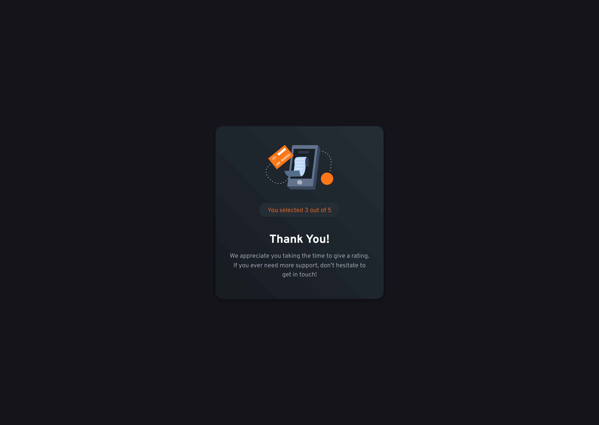

# Frontend Mentor - Interactive rating component solution

This is a solution to the [Interactive rating component challenge on Frontend Mentor](https://www.frontendmentor.io/challenges/interactive-rating-component-koxpeBUmI).

## Table of contents

- [Overview](#overview)
  - [The challenge](#the-challenge)
  - [Screenshot](#screenshot)
  - [Links](#links)
- [My process](#my-process)
  - [Built with](#built-with)
  - [What I learned](#what-i-learned)
  - [Continued development](#continued-development)
  - [Useful resources](#useful-resources)
- [Author](#author)
- [Acknowledgments](#acknowledgments)

## Overview

### The challenge

Users should be able to:

- View the optimal layout for the app depending on their device's screen size
- See hover states for all interactive elements on the page
- Select and submit a number rating
- See the "Thank you" card state after submitting a rating

### Screenshot

|                                     Rating Card                                      |                                        Thanks Card                                         |
| :----------------------------------------------------------------------------------: | :----------------------------------------------------------------------------------------: |
|  |  |

### Links

- [Live Site URL Here](https://interactive-rating-component-ts-live.pages.dev/)
- [Solution URL Here](https://github.com/mustafa-abu-eisha/interactive-rating-component-ts)

## My process

### Built with

- Semantic HTML5 markup
- Mobile-first workflow
- [React](https://reactjs.org/) - JS library
- [TypeScript](https://www.typescriptlang.org/) - Strongly typed programming language
- [Tailwind CSS](https://tailwindcss.com/) - Utility-first CSS framework
- Flexbox & CSS Grid

### What I learned

Building this component with React, TypeScript, and Tailwind CSS allowed me to refine state management and type safety for interactive UI elements.

Here is how I structured the rating state and submission handling using TypeScript:

```tsx
import { useState } from 'react';
import type { JSX } from "react/jsx-runtime";

export default function App(): JSX.Element {
  const [starCount, setStarCount] = useState<number>(0);
  const [isRated, setIsRated] = useState<boolean>(false);

  const handleSelectStar = (count: number): void => {
    setStarCount(count);
  };

  const handleRating = (): void => {
    setIsRated((prev: boolean): boolean => !prev);
  };

  return (
    // Component markup
  );
}
```

I also leveraged Tailwind CSS utility classes to manage dynamic hover and active states efficiently:

```html
<button
  className="btn h-11 uppercase tracking-widest w-full flex-center rounded-4xl bg-primary text-gray-900 hover:bg-light hover:text-gray-900 focus-visible:bg-light focus-visible:text-gray-900 focus-visible:outline-0 focus-visible:hover:bg-light focus-visible:hover:text-gray-900 disabled:cursor-no-drop transition duration-300"
>
  Submit
</button>
```

### Continued development

In future projects, I want to continue focusing on:

- Improving accessibility (a11y) for custom form components and keyboard navigation.
- Exploring state management libraries like Zustand or React Context for larger components.
- Advanced Tailwind CSS techniques like custom plugin creation and design token organization.

### Useful resources

- [React Documentation](https://react.dev) - The updated React documentation helped me structure conditional rendering cleanly.
- [Tailwind CSS Docs](https://tailwindcss.com/docs) - Excellent resource for quick reference on utility classes and responsive breakpoints.
- [TypeScript Handbook](https://www.typescriptlang.org/docs/handbook/intro.html) - Helpful reference for typing event handlers and React component props.

## Author

- [Frontend Mentor Profile](https://www.frontendmentor.io/profile/mustafa-abu-eisha)
- [GitHub Profile](https://github.com/mustafa-abu-eisha)

## Acknowledgments

Thanks to the Frontend Mentor community for providing realistic design challenges that help refine frontend development skills.
